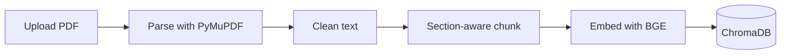

# PaperPilot

[](https://github.com/rohithkhannanukala1990-cell/paper_pilot/actions/workflows/tests.yml)

A RAG research-paper assistant that summarizes papers, answers questions with numbered citations, and compares papers.


## Why it exists

Reading and comparing research PDFs is slow when you only need grounded answers with citations you can check. PaperPilot keeps a small, plain-Python RAG stack (no LangChain / LlamaIndex) so ingestion, retrieval, and generation stay inspectable and easy to swap.

## Architecture

### Ingestion



### Q&A


`settings.retriever` selects `vector`, `hybrid` (BM25 + vector RRF), or `rerank` (hybrid top-20 then BGE reranker top-5). Streamlit streams answers via `ask_stream`; the REST API uses non-streaming `ask`.

## Features

- PDF ingest with size/page limits, section-aware chunking, and Chroma persistence
- Ask / summarize / compare over one or more papers with numbered citations
- Retrievers: dense vector, hybrid BM25+RRF, optional cross-encoder rerank
- Streamlit UI, FastAPI (`api.py`), CLI scripts under `scripts/`
- Offline pytest suite and GitHub Actions CI

### Quick start (Docker)

```powershell
Copy-Item .env.example .env   # set ANTHROPIC_API_KEY
docker compose up --build
```

UI: http://127.0.0.1:8501 · API: http://127.0.0.1:8000 · OpenAPI: http://127.0.0.1:8000/docs

### Local PowerShell setup

```powershell
py -3.11 -m venv .venv
.\.venv\Scripts\Activate.ps1
pip install -r requirements.txt
Copy-Item .env.example .env   # set ANTHROPIC_API_KEY
# put PDFs in data\papers, then:
python scripts\index_folder.py
streamlit run streamlit_app.py
```

## Evaluation

Metrics below are copied from `eval/results.csv` only (placeholder `golden.jsonl`, empty index at the time of these runs). Faithfulness / refusal / latency cells were blank (`--skip-answers`).

| timestamp (UTC) | chunk_words | chunk_overlap | embed_model | k | retriever | n | hit@k | MRR | faithful | correct_refusals | latency_s |
| --- | ---: | ---: | --- | ---: | --- | ---: | ---: | ---: | --- | --- | --- |
| 2026-10-19T15:56:48Z | 220 | 40 | BAAI/bge-small-en-v1.5 | 6 | vector | 2 | 0.0000 | 0.0000 | — | — | — |
| 2026-10-19T15:56:58Z | 220 | 40 | BAAI/bge-small-en-v1.5 | 6 | hybrid | 2 | 0.0000 | 0.0000 | — | — | — |
| 2026-10-19T15:57:08Z | 220 | 40 | BAAI/bge-small-en-v1.5 | 6 | rerank | 2 | 0.0000 | 0.0000 | — | — | — |

**vector** — TODO: conclusion

**hybrid** — TODO: conclusion

**rerank** — TODO: conclusion

Re-run after filling `eval/golden.jsonl` and indexing papers:

```powershell
python -m eval.run_eval --retriever vector
python -m eval.run_eval --retriever hybrid
python -m eval.run_eval --retriever rerank
```

## Design decisions and trade-offs

- **220-word section-aware chunks with 40-word overlap.** Chunks never cross section boundaries; overlap carries only within a section so Methods is not polluted by Introduction tails. Short leftovers under 30 words are dropped.
- **BGE query prefix.** Document embeds are bare text; queries use `Represent this sentence for searching relevant passages: ` for asymmetric retrieval with `BAAI/bge-small-en-v1.5`.
- **No LangChain / LlamaIndex.** Explicit modules (`ingest`, `store`, `prompts`, `llm`, `service`) keep boundaries clear; only `llm.py` imports Anthropic.
- **Per-paper retrieval for comparisons.** Each aspect is searched per paper (k=3) so one long PDF cannot crowd others out of a shared top-k.
- **Facet summaries vs map-reduce.** `summarize` runs five concurrent facet Q&As (`FACETS`) then a short TL;DR from the notes—cheaper/clearer than a full map-reduce over every chunk.
- **Hybrid / rerank.** Hybrid fuses BM25 and vector top-20 with RRF after dropping weak vector hits; rerank takes that pool and keeps top-5 by cross-encoder score. See the evaluation table for measured hit@k / MRR.
- **MIN_SCORE = 0.30.** Vector `ask` filters hits below this before generation; hybrid/rerank apply the threshold to vector candidates before fusion so BM25-only hits can still surface.

## Limitations and future work

- Scanned / image-only PDFs yield little text (no OCR yet)
- Tables and equations are flattened as noisy text
- Section labels rely on a heading regex; nonstandard headings stay in “Front Matter”
- Eval set is small and self-written; the CSV rows above are not a meaningful quality baseline until golden questions and an index exist
- LLM-as-judge can be biased or unparseable (treated as a miss)
- Prompt injection via PDF text remains a residual risk (see Security notes)

## Project layout

```
paperpilot/          # library (config, ingest, store, hybrid, rerank, prompts, llm, service)
api.py               # FastAPI
streamlit_app.py     # UI
scripts/             # index_folder, ask_shell, inspect_chunks
eval/                # golden.jsonl, run_eval, results.csv
tests/               # offline pytest
docs/                # demo.gif, swagger.png (screenshots)
```

## Running tests

```powershell
pip install -r requirements.txt
pytest -q
```

CI installs a thinner dependency set (no torch) and runs the same suite on push / pull request.

## License

MIT

## Papers

No PDFs are committed. Link the arXiv abstracts you indexed for demos and eval:

- TODO: [Paper title](https://arxiv.org/abs/XXXX.XXXXX)
- TODO: [Paper title](https://arxiv.org/abs/XXXX.XXXXX)

## API docs screenshot


## Security notes

- **Prompt injection via PDF text.** Extracted paper text is treated as untrusted data. System prompts instruct the model to ignore instructions found inside passages, but a determined adversary can still try to steer answers through malicious PDF content. Prefer papers from sources you trust, and treat model output as advisory—not authoritative.
- **Secrets handling.** API keys and other secrets must live in environment variables (see `.env.example`). Never hardcode keys in source, notebooks, or commits. `.env` is gitignored; keep it out of screenshots and shared logs. Logs intentionally omit prompts and document text.
- **Cost abuse.** Each question, summary, and comparison calls a paid LLM (and summaries run several facet calls in parallel). Upload limits (`MAX_UPLOAD_MB`, `MAX_PAGES`) reduce runaway ingest cost; still avoid exposing an unauthenticated public endpoint without rate limits, auth, and spend caps on the provider account.

## Run the API

```powershell
uvicorn api:app --reload --port 8000
```

Upload a PDF:

```powershell
Invoke-RestMethod -Method Post -Uri http://127.0.0.1:8000/papers `
  -Form @{ file = Get-Item -Path .\data\papers\example.pdf }
```

Ask a question:

```powershell
Invoke-RestMethod -Method Post -Uri http://127.0.0.1:8000/ask `
  -ContentType "application/json" `
  -Body '{"question":"What is the main contribution of the paper?"}'
```
